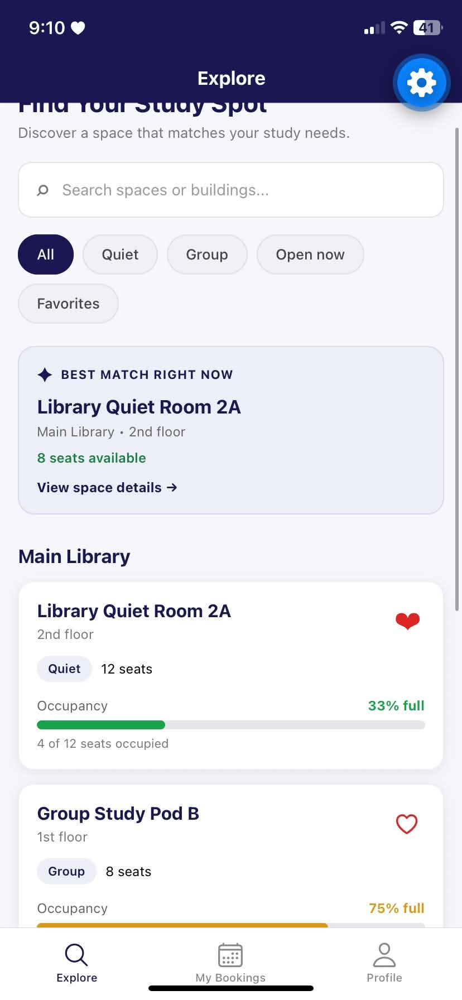
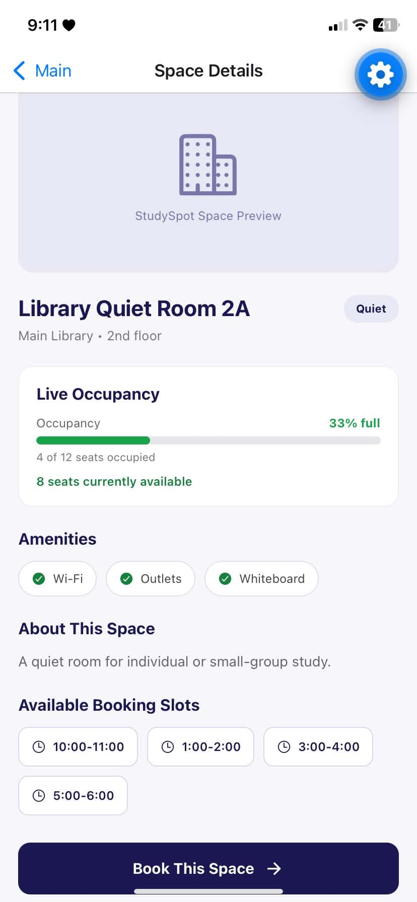
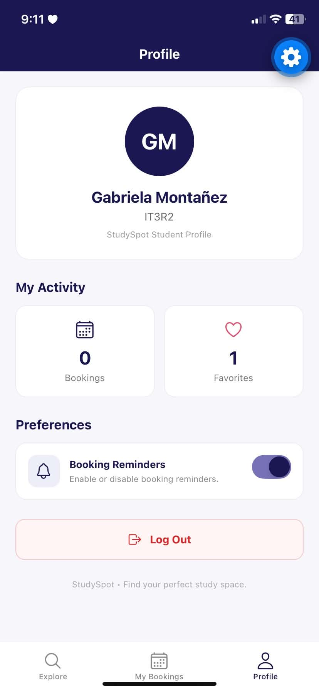

# StudySpot — Study Space Finder and Booking App

## Project Description

**StudySpot** is a mobile application developed using React Native and Expo that helps students discover available study spaces, view space information, and reserve study slots within their campus.

The application allows students to search and filter study spaces, check occupancy information, manage their favorite spaces, and create or cancel bookings through a simple and user-friendly interface.

This project was developed as a requirement for IT313.

## Features

### 1. Login and Student Information
- Simulated student login using full name and section.
- Controlled text input fields.
- Inline validation for empty fields.
- Conditional navigation based on login status.

### 2. Explore Study Spaces
- Displays available study spaces grouped by building.
- Shows space name, building, floor, type, and seat capacity.
- Displays occupancy information through an occupancy bar.
- Supports searching by space name, building, and type.

### 3. Search and Filters
Students can filter study spaces using:
- All
- Quiet
- Group
- Open Now
- Favorites

An empty-state message appears when no study spaces match the search or selected filter.

### 4. Best Match Right Now
The application recommends a suitable study space based on the following conditions:
- The space must be a Quiet study space.
- It must have available seats.
- It must have at least one available booking slot.
- Among eligible spaces, the one with the lowest occupancy ratio is recommended.

The recommendation updates according to the currently filtered study spaces. A no-match message is displayed when no suitable space is available.

### 5. Space Details
- Displays the selected study space's information.
- Shows building, floor, type, and occupancy.
- Displays available amenities and description.
- Shows available and booked time slots.
- Includes a favorite button.
- Provides a Book This Space button.
- Displays a not-found message for invalid space IDs.

### 6. Booking System
- Allows students to select an available booking slot.
- Prevents selection of already booked slots.
- Allows group size selection based on the space's seat capacity.
- Requires a booking purpose with at least 10 characters.
- Includes inline validation.
- Disables confirmation until the required information is valid.

### 7. My Bookings
- Displays confirmed bookings.
- Shows the study space, date, time slot, group size, and purpose.
- Allows students to cancel bookings.
- Includes cancellation confirmation.
- Prevents duplicate bookings for the same space and time slot.
- Displays an empty state when there are no bookings.

### 8. Student Profile
- Displays student name and section.
- Generates avatar initials from the student's name.
- Displays booking and favorite counts.
- Includes a reminders toggle.
- Provides a logout function.

### 9. Responsive Layout
- Supports portrait and landscape orientations.
- Uses a one-column layout on narrower screens.
- Uses a two-column layout when the screen width is at least 600 pixels.
- Uses platform-specific styling through `Platform.select`.

## Own Enhancement

**Favorites Filter**

The Favorites filter allows students to display only the study spaces they have marked as favorites.

The favorite status is synchronized between the Explore screen, Space Details screen, and Profile screen. Students can add or remove favorites using the heart icon.

## Technologies Used

- **React Native** – Mobile application development.
- **Expo** – Development and testing environment.
- **TypeScript** – Type safety.
- **React Navigation 7** – Application navigation.
- **React Native StyleSheet** – Component styling.
- **@expo/vector-icons** – Navigation and interface icons.
- **React Hooks** – State management using `useState` and `useMemo`.

## Navigation Structure

The application uses a conditional root stack navigator and a bottom tab navigator.

### Root Stack Navigator

| Screen | Route Parameters | Purpose |
|---|---|---|
| Login | None | Student login |
| Main | None | Main application tabs |
| SpaceDetails | `spaceId` | Displays study space information |
| Booking | `spaceId` | Opens the booking modal |

### Bottom Tab Navigator

| Tab | Purpose |
|---|---|
| Explore | Search and discover study spaces |
| Bookings | View and manage bookings |
| Profile | View student information and settings |

The Login screen is displayed when the student is signed out. The Main screen and other application screens are accessible after successful login.

## Route Parameters

The application uses a typed `RootStackParamList` and `TabParamList`.

The following route parameters are defined:

- `SpaceDetails`: Receives `spaceId` to identify the selected study space.
- `Booking`: Receives `spaceId` to identify the study space being booked.
- `Login`, `Main`, `Explore`, `Bookings`, and `Profile`: Do not require route parameters.

Navigation parameters are defined in `types/navigation.ts`.

## Data and State Management

StudySpot uses in-memory data and React state management.

The application does not use a backend server or external database.

The following information is managed in the main `App.tsx` component:

- Student information
- Favorite study spaces
- Booking records
- Reminder toggle state

Shared state is passed to the appropriate screens through props.

## Installation and Setup

### Prerequisites

- Node.js and npm
- Git
- Visual Studio Code
- Expo Go application

### Installation Steps

1. Clone the repository:

   ```bash
   git clone https://github.com/gsdmtanez/IT313_Montanez_Gabriela_StudySpot.git
   ```

2. Navigate to the project directory:

   ```bash
   cd IT313_Montanez_Gabriela_StudySpot
   ```

3. Install the project dependencies:

   ```bash
   npm install
   ```

4. Start the Expo development server:

   ```bash
   npx expo start
   ```

5. Open Expo Go on your mobile device and scan the QR code to run the application.

## Project Screenshots

### Explore Screen


### Space Details Screen


### Profile Screen


## Project Structure

```text
IT313_Montanez_Gabriela_StudySpot/
│
├── components/
│   ├── FilterChip.tsx
│   ├── OccupancyBar.tsx
│   └── SpaceCard.tsx
│
├── data/
│   └── spaces.ts
│
├── navigation/
│   ├── MainTabs.tsx
│   └── RootNavigator.tsx
│
├── screens/
│   ├── BookingScreen.tsx
│   ├── BookingsScreen.tsx
│   ├── ExploreScreen.tsx
│   ├── LoginScreen.tsx
│   ├── ProfileScreen.tsx
│   └── SpaceDetailsScreen.tsx
│
├── types/
│   └── navigation.ts
│
├── App.tsx
├── app.json
├── package.json
├── package-lock.json
└── README.md
```

## Important Notes

- Student login is simulated.
- Application data is stored in memory and is not permanently saved.
- The reminders toggle changes its state but does not send actual notifications.
- The Open Now filter uses available seat capacity as its availability condition.
- The application was tested using Expo Go on an iOS device.


---

**IT313**  
**Name: Gabriela Shaine D. Montanez**
**Section: IT3R2**